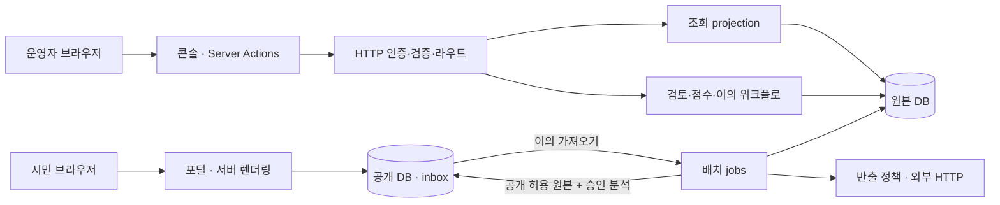

# 파랑새(Bluebird) 구현 아키텍처 — 로컬 시연 구조

- 갱신 2026-10-13
- 순서: 실행 구조 → 의존 방향 → 공개 불변식. 문서 끝 §0 = 인수 시점·기획서 원래 요구사항 기록

---

## 1. 구성

- 로컬 시연 구조: 팀원이 Docker로 자기 PC에서 실행
- 기동·종료 = `./demo.sh` 하나
- 모든 포트 = 127.0.0.1 전용

| 서비스 | 하는 일 | 주소 |
|---|---|---|
| `db` | PostgreSQL 16 + pgvector 1개. DB 2개: `bluebird_core`(원본), `bluebird_publish`(공개) | 127.0.0.1:54329 |
| `api` | FastAPI(`bluebird.api`). 콘솔의 유일한 백엔드. DB 계정 `bb_api` | 127.0.0.1:8000 |
| `portal` | 공개 화면(Next.js). 공개 DB 읽기 + 이의 제기 쓰기만. DB 계정 `bb_portal` | 127.0.0.1:3000 |
| `console` | 담당자 검토 화면(Next.js). `api`와만 통신 | 127.0.0.1:3001 |
| `jobs` | `bluebird` 명령(수집·카드·신호·소스 점검·이의 가져오기·공개·KPI). 평시 종료, `./demo.sh job <명령>`으로 실행 | 없음 |



- 키·DB 비밀번호 = 루트 `.env`(git 제외). 양식 = `.env.example`
- 실행 중 생성 파일(시드 CSV, 익명화 비밀값, 콘솔 토큰) = `.runtime/`(git 제외)
- 원본 자료(`reference/`, `data/`) = 수상자 이름 포함 → git 제외, 팀원 별도 전달
- 외부 호출 = `pipeline/bluebird/egress.py`만. 허용 주소 목록 확인 + 호출마다 `core.egress_call` 기록. 프록시 미사용(선택: `BLUEBIRD_EGRESS_PROXY`)
- DB 비밀번호 1개(`DB_PASSWORD`) 공용. 계정 = `bluebird`(슈퍼유저, jobs·원본 DB), `bb_api`, `bb_migrator`, `bb_publisher`, `bb_inbox_reader`, `bb_portal`. 생성 = `deploy/local/initdb/00-init.sh`
- 공개 화면: 보안 헤더 자체 부착(`next.config.ts`), GET/HEAD/POST 외 = 405. 콘솔 = 자체 CSP. 요청 횟수 제한 없음(시연용)

### 1.1 코드 경계와 의존 규칙

| 경계 | 소유 코드 | 의존 방향 |
|---|---|---|
| API 조립 | `pipeline/bluebird/api.py` | HTTP 라우터를 등록하고 서버를 실행. 기존 ASGI·모듈 실행 진입점 유지 |
| HTTP 어댑터 | `bluebird/http/auth.py`, `schemas.py`, `routes.py`, `config.py` | 인증·역할·형식 검증·상태 코드 변환. SQL을 직접 실행하지 않음 |
| 읽기 모델 | `bluebird/http/queries.py` | DSN을 인자로 받아 DB projection 반환. FastAPI에 의존하지 않음 |
| 쓰기 워크플로 | `funnel.py`, `objections.py`, `score.py`, DB 제약·트리거 | 승인·철회·점수·코딩 규칙과 트랜잭션 소유. HTTP를 역으로 import하지 않음 |
| 포털 데이터 | `web/portal/lib/{connection,types,input,ideas,revival,exploration,statistics,objections}.ts` | 연결·자료형·입력 규칙·조회/접수 분리. 공개 DB만 접근 |
| 포털 표현 | `web/portal/app`의 페이지·사례·근거 컴포넌트 | 서버에서 데이터를 읽어 전달. 검색·근거 본문을 GPU 클라이언트에 넣지 않음 |
| 콘솔 전송·계약 | `web/console/lib/{api,contracts,action-state}.ts`, `app/actions.ts` | 서버 전용 인증 전송·응답 타입·변경 요청. DB 연결 없음 |
| 콘솔 표현 | `web/console/features/{overview,queue,ideas,coding,objections}` | 라우트는 입력과 로딩, 기능 컴포넌트는 화면 구성. 전송 중 상태만 클라이언트 관리 |

- 분리 = 책임이 달라지는 곳만. 범용 서비스/리포지터리 클래스, 구 경로 재수출, 동일 계약 중복 구현 없음
- 권한 강제 = API + DB(메뉴 숨김 아님)
- 판정 경계 = HTTP 요청 스키마 + SQL 제약. 화면 안내 문구 = 규칙 아님

### 1.2 도구 독립성과 최소 의존성

- Claude·Codex·GJC·개인 경로 = 설치·실행·검증 전제 아님. `.gjc/` 등 로컬 이력 = 무시되는 개발 산출물, 애플리케이션 미참조. 기존 이력 삭제 없음
- 필수 실행 의존성 = Next.js·React·PostgreSQL 드라이버, FastAPI·psycopg·외부 HTTP/파일 어댑터, WebGPU 라이브러리
- 설치 = npm/uv 잠금 파일. 런타임 이미지 = 개발 도구 없음
- 새 UI 프레임워크·차트·폰트 패키지 추가 없음
- 구성도 HTML = Python 표준 라이브러리만으로 생성·미리보기. PDF = 로컬 Chromium 명시 시만

## 2. 지키는 원칙

1. **원본 DB / 공개 DB 분리.** 공개 원본 풀 통제 = 소스 `public_ok` + 반출 컬럼 허용목록. 진단·변화·시의성 분석 = 별도 사람 최종 승인 + 공개 허용 필요. `withheld_at` 자료 = 양쪽 모두 미반출
2. **이름 = 적재 시 삭제.** 팀 이름·사람 이름 미저장, 익명 ID만
3. **모든 판정에 근거 URL.** 근거 없음 → 원인 `U`, 시의성 항목 점수 없음
4. **AI 제안 → 사람 승인 → 공개**
5. **이의 제기 왕복.** 포털 → 공개 DB inbox → jobs 가져오기 → 원본 DB → 콘솔 처리 → 다음 공개 반영
6. **목표 측정 = KPI G1–G13**(§8)
7. **외부 전송 = 허용 자료만.** 상용 AI(OpenAI·Anthropic) 전송 = 외부 반출 허용 자료(O급 또는 기관 허용 범위)만. 전송 전 `egress.py` 확인. 운영 이관 시 보안 등급(N2SF)·클라우드 인증(CSAP) = 운영기관 보안담당과 별도 확정

- 기준 도식: `docs/diagrams/`

---

## 3. 구성요소별 상세

### 3.1 jobs (배치)

- `pipeline/` 이미지 1개로 `bluebird` 명령 실행. 리스너 없음
- `./demo.sh cycle` = 기본 원본 적재·점검·승인분 공개·화면 기동
- 추가 외부 원본 수집 = `./demo.sh collect`

| 명령 | 하는 일 |
|---|---|
| `ingest` | seed 파일 → core 적재. 수상자 성명·소속·팀 이름 = 적재 시 삭제, 익명 ID(`ID-YYYY-xxxxxxxxxx`)만 |
| `collect contests` | 공식 CSV·과학관·KIDP 목록·제안 OpenAPI(서울 3종·국민신문고·경기, `collect_proposals.py`)·KIPRIS 아이디어DB(`collect_kipris.py`) → 명시적 매핑·익명화 → 기존 `ingest`. 국민신문고 = 호출 예산 내 증분, 이전 CSV 병합. 공모전 출품·수상 / 시민제안 구분 = `core.source.record_kind` |
| `cards` | 아이디어 카드 생성. `card_kind` = `full`(상용 LLM 본문 읽음) / `local_extract`(로컬 규칙 추출) / `title_only`(제목만) |
| `sources check` | 데이터 소스 실제 수신 가능 여부 점검(`core.source_check`) |
| `signals catalog-fetch` / `catalog-import` | 공공데이터 목록개방현황 스냅샷 내려받기·가져오기 → 바뀐 것 신호 |
| `trace local` / `trace refresh` / `diagnose rule` | 키 없이 로컬 자료에 근거한 흔적·규칙 진단. 외부 검색 실시로 기록하지 않음 |
| `trace auto` | NAVER 뉴스(API HUB)·KIPRIS 특허/실용신안 각 첫 페이지 최대 10건. 발견 = 후보, 자동 사업화 확정 아님 |
| `diagnose auto` / `score auto` | P2 원문 발췌 검증 / P3 기존 변화 근거·축 검증. 기본 1건·최대 20건, `--idea` 지정, 사람 입력 보존, 승인 없음 |
| `trace manual` / `diagnose manual` / `changes` / `match` / `score` | 담당자 근거·판단 입력과 변화 연결 |
| `review` / `top` / `funnel` | 검토·승인, 이번 주 Top 20, 깔때기 단계 보고 |
| `announce` | 공고 등록(키 없음 → 사람이 공고 URL·제목·기간 입력) |
| `publish` | 공개 허용 원본 + 승인된 분석을 공개 DB로 교체 |
| `objections pull` / `resolve` | 공개 DB inbox의 이의 가져오기(가져온 행은 inbox에서 삭제) / 처리 |
| `coding sample`, `kappa` | κ용 표본 만들기, 일치도 계산 |
| `eval goldset`, `verify top20` | 골드셋 회귀 / 공개 Top 20 = 전문가 승인 확인 |
| `kpi report` | G1–G13 현황표(사람 입력 대기 `human_blocked`, 키 대기 `key_required`, 진행 중 `in_progress`). G3 = 100건 이상 표본만 통과, G4 = 기준선(`eval goldset --baseline`) 후만 통과, G5 목표 = `--top-target`(E3 승인 시) |

- 외부 HTTP = `pipeline/bluebird/egress.py`만. 타 모듈 직접 HTTP 불가. egress = 허용 도메인 확인 + 호출마다 `core.egress_call` + 반출 허용 필드(`core.export_policy`)만 전송
- 자동 보강 = `enrichment.py`. 대상 = 반출 허용 O급 + 현재 유효 아이디어만
  - 뉴스·특허 검색 실패 = `not_run`(검색 결과 없음과 구분)
  - P2: 모델 반환 발췌 = 실제 본문 확인. URL 근거 연결 = 서버
  - P3: 기존 변화 근거 ID만 수신. 축별 URL 연결 = 서버
  - 점수 = 정수 0–5 또는 `null`. 기존 사람 진단·점수 이력 덮어쓰기 없음. 모델 호출 기록·버전 보존
- `./demo.sh cycle` = 카드·로컬 흔적 판정·규칙 진단·변화 매칭 생성 없음. 해당 분석·외부 자동 보강 = 별도 명령만
- `./demo.sh publish` = 이의 가져오기 → 기존 승인 대상 Top 선정 → 공개. 사람 승인 대체 경로 없음

추가 원본 수집 경계:

- `collection.py`: 출처 레지스트리 → Egress → 임시 후보 파일 → 스키마·행 검증 → `ingest` → 동일 볼륨 내 정상 파일 교체
- `collect_science.py`: 공식 연도별 출품작 목록. 2015년 이후만. 기존 KIPRIS 1979–2014와 구분
- `collect_design.py`: 공식 KIDP 공개 갤러리 제품·공간·서비스·공예 수상 메타데이터. 이미지·첨부·참가자 정보 미저장
- `/seed` = 기존 원본 읽기 전용. `/signals/contests` = 신규 원본 비공개 파일. API·포털·콘솔 = 수집 쓰기 권한 없음
- 원천 ID 없음 → 명시적 수집 콘텐츠 기준 ID 계산. 순번·연락처 등 제외 컬럼 변경 = ID 불변. 출처 간 임의 병합 없음
- Egress = 허용 호스트·리디렉션·응답 크기 스트림 소비 중 확인 + 감사 기록. 원본 내용 = 수집 요청에 미포함
- 신규 수집 권한 = 보류. 수집 성공 ≠ 공개·상용 AI 반출·사업화 실패 판단·검토 승인
- 예약 실행기 없음. 공공데이터 카탈로그 행·지원사업 공고 = 아이디어 건수 제외


### 3.2 api (FastAPI)

- `python -m bluebird.api`. 콘솔 유일 백엔드
- 원본 DB 접속 = 최소 권한 역할 `bb_api`(0008 + 작성 권한 0010)
- 접근 토큰 = 사람별 발급. 서버 보관 = sha256 해시만(`console_users.json`)

역할:

| 역할 | 할 수 있는 일 |
|---|---|
| `reviewer` | 흔적·진단·변화 연결·시의성 작성, 최종 승인·반려(`review.round = final`), 이의 처리 |
| `coder` | 2인 독립 코딩. 자기 코드만 열람(맹검). 큐·상세 열람 불가 |
| `expert` | 전문가 승인 라운드(Top 20) |
| `auditor` | 감사 라운드, 이의 열람 |

주요 API 계약:

| API | 계약 |
|---|---|
| `GET /api/overview` | 전체 원본 `counts.raw`·분석 깔때기·소스 권한·마지막 점검·배치·공개 상태. 비밀키·원본 외부 응답 본문 미전송 |
| `GET /api/queue` | 기본 `raw` = 카드 없는 활성·공개중단 전 원본 포함. `s0–s6` = 다음 단계 미통과 큐. 검색어, `limit` 1–500, `offset` ≥0 → `items,total,counts` |
| `GET /api/ideas/{id}` | 원본 제목·본문·수상·공식 `source_url`, 카드·근거·승인 이력. 카드 없는 원본 조회 가능. 이의 본문 = reviewer/auditor만 |
| `GET /api/changes` | 이미 등록된 변화 검색 |
| `POST /api/ideas/{id}/trace` | `found`/`none`, 상태·URL·검토 메모 |
| `POST /api/ideas/{id}/diagnosis` | 코드·설명·근거 URL과 선택적 발췌 |
| `POST /api/ideas/{id}/match` | 변화 ID·판정·달라진 점·가능해진 방식 |
| `POST /api/ideas/{id}/score` | 4축별 엄격한 정수 0–5 또는 `null`, 축별 URL, 기준일 |

- 작성자 = 인증 토큰 기준(요청 사용자 이름 아님)
- 상태 코드: 권한 위반 403 / 없는 아이디어 404 / 단계 충돌 409 / 형식 오류 422
- 마이그레이션 0010 = 필요한 테이블 열·시퀀스 권한만. 소스 정책·배치·외부 호출 권한 없음
- 실질적 흔적 상태·근거 변경 → 기존 분석 승인 철회


### 3.3 console (web/console)

- 관리자용 Next.js
- 운영 개요: 공개에 가까운 미통과 단계 → 연결 점검 → 공개 반영 순 안내(누적 단계 단순 나열 아님). 미통과 건수 = 누적 통과 수 차이, 보류·제외 포함 명시
- 검색 큐·상세 작성/승인·독립 코딩·이의 처리 = 기능별 컴포넌트
- Server Action = API 호출만. DB 직접 접속 없음
- `getMe`·`requireMe` = 현재 토큰 키 React 요청 범위 캐시 공유. 프로세스 전체 인증 캐시·구 결과 보관 캐시 없음

### 3.4 원본 DB (`bluebird_core`)

- PostgreSQL 16 + pgvector + pg_trgm. 스키마 `core`
- 스키마 유일 소유자 = 마이그레이션 0001–0014(§5)

### 3.5 공개 DB (`bluebird_publish`)

- 원본 DB와 같은 Postgres 내 별도 DB
- 스키마: `publish`(승인분 사본), `meta`(템플릿·스냅샷 기록), `inbox`(이의 제기)

역할:

| 역할 | 권한 |
|---|---|
| `migrator` (`bb_migrator`) | 스키마 변경 |
| `bb_publisher` | 매 주기 `publish_next` 생성 → RENAME 교체 |
| `bb_inbox_reader` | inbox 읽기·삭제만 |
| `bb_portal` | publish 읽기 + inbox INSERT만 |

- 갱신 = 새 스키마 생성 → RENAME. 포털 = 이전 또는 새 스냅샷만 조회

### 3.6 portal (web/portal)

- Next.js. 공개 DB `bb_portal` 읽기 + 이의 제기 inbox INSERT만. 원본 DB 연결 정보 없음
- 보안 헤더 = `next.config.ts`. 미들웨어 = GET/HEAD/POST 외 405

- 화면 구조: 좁은 메뉴 레일·검색 필터·큰 기록 작업면·비대칭 상세 패널·주간 선정·검토 도구
- 홈 데이터: `listIdeas`로 8건 + 전체 수 조회. 출처·주간 선정 병렬 로드. 필터 제출 = `/pool` 기존 파싱 경로
- 상호작용 경계: 서버 조회 기록의 표시 필드·ID만 `RecordWorkbench` 전달. 클라이언트 = 선택 상태·키보드 이동만, 원문·근거 본문 미전달. 세로 탭 목록 + 연결 패널로 선택·초점 표시
- 목록 계약: `/pool`·공개 API 기본 페이지 50건 유지. 전역 레이아웃 집계 SQL 없음
- 표현 규칙: 라벨·불릿·상태 표시 우선. 원문·진단 사유·변화 설명·근거 발췌 = 접기 안 원문 보존
- 공통 표면: 흰 작업면·검정 선택/버튼·회색 경계선·명확한 초점. 상태 구분 = 문구·채움·테두리. 좁은 화면 = 상세 패널 아래 배치, 표 = 영역 내 가로 스크롤
- 그래픽 경계: 루트 `DashboardAtmosphere` = 포털 전체 경로 배경. 검색·목록·폼 = HTML
- 렌더러: `shaders@4.0.2`(MIT) 코어 API + `FlowingGradient`. 무채색 단일 캔버스·CSS 점 격자. 작은 카드 일러스트 대신 전체 작업 표면 통합
- 비용 제한: `setResolutionScale(0.5)`, `setFrameRateCap(24)`, DPR·뷰포트 기반 버퍼 ≤ 60만 픽셀. 초기화 = 1×1 CSS 픽셀
- 수명: 1024px 이상·세밀한 포인터·모션 허용·GPU·탭 가시성 조건 지연 로드. 일시 정지·숨긴 탭 = 렌더러 정리. 작은 화면·모션 감소·GPU 불가·실패 = CSS 배경
- 의존성: 코어 렌더러 telemetry collector 미시작. 콘솔 = 추가 GPU 의존성 없이 동일 정적 표면. [라이브러리 가이드](https://shaders.com/docs/guide)
- 글꼴: 양쪽 앱 Pretendard Variable 1.3.9 + SIL OFL = 로컬 `public/fonts/pretendard-1.3.9/`. WOFF2·`unicode-range` 필요 글자 묶음만, `font-display: swap`. 버전 경로 = 장기 immutable 캐시. 전체 preload 없음. CDN·Google Fonts·계정 로그인 불필요. 이미지별 폰트 파일 포함(독립 배포)


### 3.7 원칙 정리

- 상용 LLM 전송 = 외부 반출 허용 데이터만. 전송 불가 소스 = `local_extract` 또는 `title_only` 카드
- 팀 이름·사람 이름 미저장(적재 시 익명화)
- 모든 판정 = 근거 URL. 근거 없는 원인 = `U`, 근거 없는 시의성 항목 = 점수 없음
- AI 제안 → 사람 승인(`review.round = final`). 승인 후 내용 변경 → 공개 철회

---

## 4. 처리 단계

```
ingest → cards → (1 흔적 → 2 막힌 이유 → 3 바뀐 것 → 시의성) → 깔때기 s0–s6 → review → publish → objections pull
```

| 단계 | 입력 → 출력 | 주기(운영) |
|---|---|---|
| ingest | seed 파일 → `idea`(익명 ID, 팀 이름 없음) | 매일(운영 시) |
| cards | `idea` → `idea_card`(`card_kind`별) | ingest 뒤(`./demo.sh cycle`이 이어서 실행) |
| signals | 목록개방현황 내려받기 → `catalog_snapshot`, `signal_dataset`, `condition_change` | 매주 |
| trace / diagnose | 흔적 → `trace_check`, `trace_verdict`; 막힌 이유 → `diagnosis` + `x_evidence` | 사람·LLM 제안 후 검토 |
| changes / match | 바뀐 것 → `condition_change`; 아이디어와 연결 → `change_match` | 신호·입력 때 |
| score | 시의성 → `timeliness` (S, 판정 now/conditional/hold) | 주 1회 |
| funnel | 아래 s0–s6 계산 | SQL 한 곳 |
| top | 이번 주 재조명 → `weekly_top` 1–20 | 주 1회 |
| review | 사람 승인(`review`), 공개 허용(`publication`) | 콘솔 |
| publish | 승인분 → 공개 DB (템플릿 v3) | 매일(운영 시) |
| objections pull | 공개 DB inbox → `core.objection` → inbox에서 삭제 | 수시 |

- 깔때기 단계 계산 = `core.funnel_stage(as_of)` SQL 함수 1개. `bluebird funnel`도 동일 함수

| 단계 | 통과 조건 |
|---|---|
| s0 | 카드 있음 |
| s1 | 흔적 판정 = `none` 또는 `award_only`(현재 진행 주체 없음) |
| s2 | 막힌 이유 ≠ `U` + 근거 있음(데이터 원인 `D` = 부족 데이터 명시) |
| s3 | 원인과 종류 일치하는 "바뀐 것" 연결됨 |
| s4 | 시의성 판정 = `now` 또는 `conditional` |
| s5 | 사람 최종 승인 + 카드·진단·시의성·바뀐 것 공개 허용 전부 |
| s6 | 공개 가능 소스 + 공개 DB 실제 반영 스냅샷 포함 |

- 공개 가능 여부 = 소스별 `public_ok`
- 승인 후 반려·원인 변경·내용 변경 → 공개 허용 철회 → s5 제외
- 이의 수용으로 원본까지 공개 중단(`withheld_at`) → 깔때기·큐·Top 제외

---

## 5. 데이터 모델

### 5.1 원본 DB (core) — 마이그레이션 `pipeline/bluebird/db/migrations/core/0001–0014`

| 묶음 | 표 |
|---|---|
| 원천 | `source`(`record_kind`·`exclude_reason` 0011·0012), `ingest_run`, `contest`(`audience` 0011), `idea`(`retired_at` 0002, `withheld_at` 0007) · `source.share_ok`(0013) |
| 카드 | `idea_card`(`card_kind`, 본문 해시·`egress_call_id` 0003), `idea_embedding` |
| 근거 | `evidence`, `x_evidence` |
| 판정 | `trace_check`, `trace_verdict`(`external_search` 0009), `diagnosis`, `timeliness` |
| 바뀐 것 | `catalog_snapshot`, `signal_dataset`, `announcement`, `condition_change`(`origin` 0004), `cause_change_kind`, `change_match`(`match_eligible` 함수 0006) |
| 선정·공개 | `weekly_top`, `review`, `publication`(승인 뒤 변경 시 철회 0005 및 흔적 변경 0010), `publish_snapshot`, `export_policy` |
| 이의·코딩 | `objection`(0007), `coding_sample` |
| 감사·운영 | `egress_call`, `source_check`, `pipeline_run` |
| 깔때기 | `core.funnel_stage(as_of)` 함수(0004), `core.revival_candidate` 뷰 |
| 선별 재료 | `exclusion_reason`·`idea_exclusion`(0012·0014). 필터링 없음. 제목 기준 중복 표시 = 0014에서 폐지 |

주요 규칙(DB 제약 강제):
- 카드 `full` = LLM 생성 + 해당 호출 감사 행 연결(0003)
- 바뀐 것 종류 = `dataset_opened`(자동 신호)·`announcement`(API 또는 사람)·`law_effective`·`policy_news`·`tech`(사람만)로 제한(0004)
- 종류 ≠ 원인 → 매칭 생성 거부(0004)

### 5.2 공개 DB (publish) — 템플릿 v3 `pipeline/bluebird/publish_template/v3.sql`

| 스키마 | 표 |
|---|---|
| `publish` | `source`, `idea`, `evidence`, `diagnosis`, `change`, `timeliness`, `weekly_top`, `announcement`, `announcement_match` |
| `meta` | `publish_template`(등록된 템플릿 체크섬), `snapshot_log` |
| `inbox` | `objection`(포털 INSERT → jobs 가져간 뒤 삭제. 중복 판정 = `uid` 0002) |

- `publish` = 템플릿 열만 반출. 제목·본문 검색용 `pg_trgm` 인덱스
- 템플릿 변경 = 새 버전 파일 + migrator 등록

### 5.3 공개 범위

| 범위 | 조건 |
|---|---|
| 원본·카드 풀 | 소스 `public_ok`, 현재 유효하고 `withheld_at` 없음. 아이디어별 분석 승인과 별개 |
| 진단 | 근거 있음 + 사람 최종 승인 |
| 시의성·바뀐 것 | 사람 최종 승인 + 공개 허용. Top 20은 전문가 승인까지 |

- 미승인 진단 = 공개 화면 내용 비표시

---

## 6. 화면

### 6.1 portal (시민·참가자)

| 경로 | 내용 |
|---|---|
| `/pool` | 아이디어 풀: 공개 아이디어 목록(제목·출처·연도·검증 여부로 거르기) |
| `/` | 아이디어 작업대: 검색·필터 + 공개 원본 8건 선택·상세 패널 + 주간 선정 + 검토 도구 |
| `/ideas/[id]` | 원본 · 사업화 흔적 확인 범위 · 정체 원인 · 시의성 4축 · 바뀐 것 · 관련 공고 · 이의 제기 |
| `/timeliness` | 시의성 재평가: 채점한 아이디어의 4축 점수·S·판정 |
| `/match` | 주제·공고 유사 검색(`pg_trgm`) + 검증 진단 분포·판정 기준 |
| `/stats` | 통계: 출처별·연도별·카드 종류·원인·판정 분포 |
| `/api/v1/ideas`, `/api/v1/ideas/[id]` | 목록·상세 |
| `/api/v1/explore` | 주제·공고 유사 검색 |
| `/api/v1/objections` | 이의 제기 접수(POST) |

### 6.2 console (담당자)

| 경로 | 내용 |
|---|---|
| `/overview` | 소스·키 대기·배치·공개 상태 |
| `/` | 단계별 검토 큐, 검색·페이지 이동 |
| `/ideas/[id]` | 흔적·진단·변화 연결·시의성 작성, 라운드별 승인·반려 |
| `/coding` | 2인 독립 코딩(서로의 코드 맹검) |
| `/objections` | 이의 제기 처리(수용 시 원본 공개 중단 선택) |
| `/login` | 토큰 로그인 |

- portal / 콘솔 = 별도 앱·이미지. 검토 기능 코드 = 공개 화면 이미지에 미포함

---

## 7. 저장소 구조

```
bluebird/
  pipeline/                 # Python 3.12, `bluebird` CLI + api
    bluebird/
      cli.py, ingest.py, cards.py, llm.py, anonymize.py
      sources.py, sources_check.py, signals/     # 소스 어댑터, 점검, 목록개방현황
      funnel.py, enrichment.py, score.py, announce.py, wording.py
      publish.py, publish_template/{v1,v2,v3}.sql # 공개 DB 반영
      objections.py, api.py                       # 도메인 처리 / API 조립
      http/{auth,schemas,routes,queries,config}.py # HTTP 경계와 읽기 모델
      egress.py                                   # 외부 HTTP는 여기만
      db/migrations/{core,publish}/               # 스키마 유일 소유자
    tests/
  web/
    portal/                 # app 표현 + lib 공개 데이터 접근
    console/                # app 라우트 + features 표현 + lib API 전송
    */public/fonts/         # 버전 고정 자체 호스팅 WOFF2·CSS·라이선스
  compose.yaml              # db, api, portal, console, jobs
  demo.sh                   # init, cycle, up, down, status, publish, check, job, verify, env, tokens, logs
  .env.example              # 키·DB 비밀번호 양식 (실제 값 = .env, git 제외)
  deploy/local/
    initdb/00-init.sh       # DB 2개와 역할 만들기
    *.toml                  # 데이터 소스 레지스트리(sources, contest-sources, science-, design-, proposal-)
    verify.sh               # 역할·공개·이의 왕복 점검 (일회용 환경 전용)
    p95.sh                  # G8 응답 속도 측정
  docs/                     # DATA.md(소스 표, export가 생성) · ARCHITECTURE.md · diagrams/
  reference/                # 인수인계 원본 (git 제외, 팀원에게 따로 전달)
  data/                     # 원본 데이터 (git 제외)
  .runtime/                 # 시드 CSV, 익명화 비밀값, 콘솔 토큰, export, logs (git 제외)
```

---

## 8. 품질·보안 검증

- 목표 = G1–G13. 현황 = `bluebird kpi report` 표. 사람 입력 대기 = `human_blocked`
- 통제·화면 검증 = `./demo.sh verify`(`deploy/local/verify.sh`)

| 목표 | 내용 |
|---|---|
| G1 | 모든 아이디어에 구조화 카드, `card_kind`별 건수 보고 |
| G2 | 공개 DB의 공개 카드 수 = 공개 가능 소스의 아이디어 수 |
| G3 | κ: 표본 100건 2인 독립 코딩 ≥0.7 (`bluebird kappa`) |
| G4 | 골드셋 50건 5클래스 회귀 (`bluebird eval goldset`) |
| G5 | 이번 주 Top 20 전부 전문가 승인 (`bluebird verify top20`) |
| G6 | 관측된 새 데이터 기반 "바뀐 것" 승인·공개 건수 |
| G7 | 실제 공고 1건에 대한 매칭 표시 |
| G8 | 주제·공고 유사 검색 응답 속도(`deploy/local/p95.sh`로 측정) |
| G9 | 공개된 진단·바뀐 것·시의성마다 근거 1개 이상 |
| G10 | 반출 통제: 허용 열 밖 0, egress 밖 HTTP 0, 성명 일치 0(`kpi report` = 원본 파일 이름 메모리 재독 → 동일 아이디어 공개 글 대조, 개수만 기록) |
| G11 | 이의 제기 왕복: 접수 → pull → inbox 삭제 → 처리 → 반영 |
| G12 | "바뀐 것" 무작위 20건 맹검 점검 정밀도 |
| G13 | `sources check` 결과(키 없는 소스 포함) |

- `verify.sh` 점검 항목: 공개 DB 역할 권한, 반출 통제·데이터 수, 원본·카드·소스 점검, 깔때기 단계, 콘솔 보안(무토큰 401, 헤더, 최소 권한 DB 계정), 포털 보안 헤더·405, 이의 제기 왕복, 공개 화면, 선별 재료 마커(필터링 없음 확인)
- `./demo.sh status` = API·포털 실제 DB 조회 + 콘솔 로그인 응답 확인. 실패 시 비정상 종료. Compose 서비스별 healthcheck 별도
- `verify.sh` = 이의 제출·처리·공개 실제 변경 → 보존 데이터 환경 실행 금지
- `pytest` `BB_TEST_DSN` = 역할 변경 권한 있는 일회용 PostgreSQL만


---

## 9. 일정 (본선 12월 중순)

| 날짜 | 내용 |
|---|---|
| 10/2 – 12/1 | 멘토링 기간. 의견을 시의성 가중치 등에 반영 |
| 10/12, 10/19 | 목록개방현황 스냅샷. 갱신 주기와 "바뀐 것" 목표치 판단 근거 |
| 10/26 | KIPRIS 약관·N2SF 회신 결정. 결과에 따라 KIPRIS 아이디어DB 공개 범위와 외부 LLM 사용 범위 확정 |
| 11/2 | E7: 추가 목표(stretch) 착수 여부 결정 |
| 11/24 – 11/30 | Top 20 전문가 검토, 바뀐 것 정밀도 점검, 반출 통제 테스트 |
| 12월 중순 | 본선. 발표 수치는 DB 실측값으로 교체, 아키텍처 그림 갱신 |

---

## 10. 결정 필요 항목 (사람 결정 = `human_blocked`)

1. **API 키**: 보유 = OpenAI·data.go.kr(K-Startup·권익위·중기부)·KIPRIS Plus·서울·경기. 막힘 = NAVER(NCP 결제 수단 등록). 키 없는 소스 = `key_required` 기록 + 사람 입력 경로
2. **KIPRIS 약관·N2SF 등급** (10/26): 공개 범위 + 외부 LLM 전송 가능 데이터 결정. 운영기관 보안담당과 확정
3. **상용 LLM 무보존·학습 미사용 설정 확인**: OpenAI 키 있음. 예산 상한·ZDR 확인 후 `cards` full 실행
4. **κ 코더 2인 지정**: 표본 100건 독립 코딩
5. **Top 20 전문가 검토자 지정**
6. **맹검 점검자(auditor) 지정**: 바뀐 것 정밀도 20건
7. **LLM 예산 상한 승인**
8. **시의성 가중치**: 초기 0.25 균등값 → 멘토링 의견 반영

## 0. 부록 — 인수 당시의 출발점

### 0.1 인수인계 패키지 실사

- 인수 시점 = 배포 가능 코드 없음. 화면 = 정적 HTML 목업 2장(예시 수치), 아키텍처 = 그림, 파이프라인 = `pplx_sdk` 종속 50건 파일럿 스크립트
- 재사용 입력:

- 흔적 검색 질의 생성 규칙(`product_name`, `clean_team`, `masked`)과 판정 프롬프트 — `03_pilot/step1·step2`
- 검수 완료 골드셋 50건 — `03_pilot/pilot_result_final.csv`
- 코드북 T·D·R·M·C·O·U 정의와 이론 배경 — 기획서 13쪽, `07_pitch/stall_cause_codebook_7_theory.md`
- 데이터 소스·API 접근조건 조사 — `06_research/datasets.md`

### 0.2 기획서에서 약속한 것 (설계 요구사항으로 고정)

| 구분 | 기획서 내용 | 쪽 |
|---|---|---|
| 핵심 기능 | ① 아이디어 풀 DB(3축 태그·군집·유사 묶음) ② 정체 원인 진단(흔적 4종 → 7코드) ③ 시의성 재평가(S 0~5) ④ 재조명 매칭·알림 | 3, 12 |
| 흔적 4종 | 뉴스·웹 / 법인·사업자 / 특허·상표 / 후속 지원사업 선정 | 12, 17 |
| 시의성 S | 기술 준비도·데이터 개방도·제도 정합성·정책 수요 4항목 가중평균. 초기 가중치 0.25 균등 → 멘토링 의견으로 조정. S≥4.0 지금 가능 / 3.0~3.9 조건부(해소 조건 명시) / <3.0 보류. 자료 없는 항목은 점수 미부여·평균에서 제외 | 14 |
| 프롬프트 | P1 카드 추출(title, problem, solution, target_user, required_data[], required_tech[], domain 9종 중 1, year, source_url, 추정 금지) / P2 원인 분류(primary, secondary≤1, confidence 0~1, rationale 2문장, evidence_ids[], 증거 없으면 U) / P3 시의성(항목별 0~5 + 근거 URL ≥1, 자료 없으면 판단 불가, 달라진 점 ≤3) | 20 |
| 신뢰성 | 표본 100건 2인 독립 코딩 κ≥0.7 후 채택 / 모든 판정에 근거 링크·수집일 / AI는 후보·근거까지, 최종 판정·공개는 담당자 확인 / 원문 변형 금지 / 이용자 이의 제기·정정 기능 | 10 |
| 데이터 원칙 | 수상자 성명·소속은 적재 단계에서 삭제, 아이디어 단위 익명 ID / 상업적 이용 금지·변경 금지 데이터 제외 / 빅카인즈 미사용 / 네이버는 API HUB / 디지털융합플랫폼 경유 우선 | 18 |
| 사용자 | 주최기관 담당자, 참가자(예비창업자·학생·직장인), 정책 기획자 | 11 |
| 정량 목표(’26.12) | 카드 1만 건+ / 진단 표본 100건 κ≥0.7 / 재발굴 후보 20건 전문가 검토 후 공개 / 공고 매칭 실사용 시연 / 유사 아이디어 조회 1초 내 / 근거 링크 100% | 15, 22, 23 |
| MVP 단계 | 1단계(~9월) 시드 적재·카드 추출·군집·진단 카드 화면 / 2단계(10~11월) 흔적 API·원인 분류·κ 검증·시의성 / 3단계(12월) 공고 매칭·알림·주최기관 모드·Top 20 공개 | 15 |

**현재 구현**:
- 로컬 서비스 연결 완료: 파일 적재·카드·근거 기반 제안·담당자 작성/승인·공개 스냅샷·시민 검색/이의·콘솔 처리
- 구현 완료 ≠ 기획서 목표 수치·외부 유료 API 실응답·약관 승인·전문가 검토 완료
- 실제 처리 단계·키 대기·승인 = DB + 운영 개요 확인

### 0.3 기획서와 실데이터의 불일치 (설계에 반영)

1. **"3.8만 행" ≠ 아이디어 수.** 벌크 TXT 기준 26,434건 → 2026-10-13 KIPRIS Plus 아이디어DB API 전수로 교체(건수 = `docs/DATA.md`). 2층 창업경진대회 수상작 = 2,190 + 70건. 화면 수치 = DB 실측값만
2. **흔적 판정 = 5클래스.** 파일럿 검수본 `realized / pivot / similar_unlinked / award_only / none`(6/4/3/14/23). 원인 코드(P2) = `realized` 아닌 건에만
3. **KIPRIS Plus 아이디어DB = 약관상 팀 내부 전용(보류).** 공개 노출 기준 = 공공데이터포털 `15006010` 파일
4. **Supabase·RAGFlow·Superset**(기획서 19, 21쪽) = 로컬 시연 부적합·불필요 → 자체 PostgreSQL+pgvector(§1)
5. **익명화 vs 흔적 검색 충돌.** 흔적 검색 = 팀명 필요 / 기획서 = "적재 단계 삭제" 약속 → 팀·사람 이름 적재 시 삭제, 익명 ID만(§3.1). 흔적 검색 = 아이템명. 약속 준수 + 검색 가능

---

