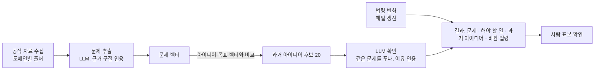

# 최근 문제 → 과거 아이디어 찾기 계획 (검토용)

목표: 최근 공식 자료에서 **지금의 문제**와 **해야 할 일**을 뽑고, 공모전·제안 DB(사용 대상 114,781건)에서 그 문제를 다룬 **과거 아이디어**를 찾아 제안. 바뀐 근거는 **시행된 법령**으로 확인

## 1. 흐름



## 2. 저장 위치

| 단계 | 위치 | 내용 |
|---|---|---|
| 지금 | 이 PC 로컬 DB(Docker `pgvector/pgvector:pg16`) | 서버 `parangsae` 사본 + 새 표. 시범은 전부 여기서 |
| 나중 | 68 서버 `parangsae` | 같은 마이그레이션 파일로 적용. 서버 PostgreSQL 이미지를 `pgvector/pgvector:pg16`으로 교체한 뒤 |

- 로컬과 서버 구조가 같도록 표 변경은 전부 마이그레이션 파일(`master/00NN`)로만 함
- 서버 반영 = 로컬 결과를 그대로 복사하지 않고, 같은 명령을 서버에서 다시 실행하거나 표 단위로 옮긴 뒤 로컬과 비교(지금까지 방식)

## 3. 새로 생기는 표 (스키마 `external`, `master/0017`)

```
parangsae
├ public   raw, master, db_log (그대로)
├ external 바깥 공식 자료
│ ├ law    법령·조례·행정규칙이 바뀐 기록
│ └ doc    정책뉴스·보도자료·국회 법률안
└ migrations
```

| 표 | 1행 | 주요 칸 |
|---|---|---|
| `external.law` | 공포 1건(추가만) | 종류, id, 법령명, 제·개정 구분, 소관 기관, 공포일, 시행일, 개정 이유, 요약(LLM), 벡터 |
| `external.doc` | 자료 1건 | 출처, id, 제목, 날짜, 기관, 도메인, 링크, 본문, 문제 한 문장(LLM), 근거 구절, 근거 확인, 벡터, 관련 아이디어(json) |

- 문제 추출·아이디어 연결 결과 = `external.doc` 칸(표 따로 안 만듦). 자료 1건 = 핵심 문제 1개
- master: `embedding_input` + `embedding`(`master/0016`)
- 제외: 기업마당(`BIZINFO_KEY`), 네이버 뉴스

## 4. 법령 최신 유지

| 항목 | 내용 |
|---|---|
| 명령 | `bluebird master law --since 2025-01-01` (끝 = 오늘, 한국 시간) |
| 법령 | 법령 변경이력 목록(`lawSearch`, `target=lsHstInf`)을 변경일 하루씩 → 연혁 포함 공포 1건 = 1행. 변경일 = 법제처 DB 수정일이라 옛 연혁도 섞여 옴 → 공포일·시행일이 범위 안인 것만 저장 |
| 개정 이유 | 법령 제정·일부개정·전부개정만 본문 조회(`lawService`). 타법개정·폐지 = 없음 |
| 자치법규 | 자치법규 목록(`target=ordin`) 시행일 범위. **현행본만 제공**(연혁 목록 API 없음) → 범위 안에서 두 번 바뀐 조례는 마지막 것만. 개정 이유 API에 없음 |
| 행정규칙 | 미수집(날짜 조건 확인 필요) |
| 출처 표기 | 행마다 `source` 칸(기관 · 서비스 · 호출 이름), 원문 = `url`(공개 페이지, 인증 코드 없음) |
| 저장 | `external.law` 한 표. 같은 공포 번호 = 덮어쓰기, 다음 개정 = 새 행 |
| 주기 | 매일 1회(예정). 전날~오늘 변경일만 |
| 현황(로컬, 2026-10-22) | 법령 10,027행(2025-01 이후 공포·시행), 개정 이유 5,095행(제정·일부·전부개정 5,100 중) · 자치법규 56,094행(2025-01-01~2026-10-22 시행) |

## 5. 지침 md

| 파일 | 내용 |
|---|---|
| `guides/domains.md` | 도메인 목록, 도메인별 자료 출처·소관 기관·법령 범위(6장 표) |
| `guides/issue.md` | 자료에서 문제·해야 할 일을 뽑는 기준과 예시. 자료에 없는 내용 금지, 근거 구절 인용 |
| `guides/match.md` | 문제와 아이디어가 "같은 문제를 푼다"의 기준과 예시(맞음·아님) |
| `guides/review.md` | 사람 표본 확인 방법, 통과 기준 |

- git으로 관리. 실행 때 지침 파일 내용의 해시를 `issue`·`match` 행에 기록 → 어느 지침으로 만든 결과인지 추적
- 지침 수정 = md만 고치면 됨(코드 변경 없음). 수정 후 다시 돌린 결과는 버전으로 구분

## 6. 도메인별 출처

| 도메인 | 아이디어 | 자료 출처(공식) | 소관 기관(법령 범위) | 상태 |
|---|---:|---|---|---|
| 생활 | 41,051 | 미정 | 미정 | **출처 필요** |
| 과학기술 | 24,605 | 과기정통부 보도자료, 규제샌드박스 승인 | 과기정통부 | 있음 |
| 안전 | 23,230 | 행안부·소방청 보도자료 | 행안부, 소방청 | 있음 |
| 복지 | 21,189 | 복지부 보도자료, 국회 법률안 제안 이유 | 복지부 | 있음 |
| 환경 | 18,660 | 환경부 보도자료 | 환경부 | 있음 |
| 행정 | 15,416 | 행안부 보도자료, 조례 | 행안부, 지자체 | 있음 |
| 문화 | 14,604 | 문체부 정책뉴스 | 문체부 | 있음 |
| 교육 | 14,307 | 교육부 보도자료 | 교육부 | 있음 |
| 교통 | 12,549 | 국토부 보도자료 | 국토부 | 있음 |
| 경제 | 8,400 | 기재부·중기부 보도자료, K-Startup·기업마당 공고 | 기재부, 중기부 | 있음 |
| 보건 | 7,992 | 복지부·질병청 보도자료 | 복지부, 질병청 | 있음 |
| 기타 | 840 | – | – | 제외 |

공통 출처: 국회 법률안 제안 이유, 입법예고·행정예고 개정 이유, 정책브리핑 정책뉴스

- 일반 뉴스: 이용 조건이 확인된 출처만 보조로. 포털 뉴스 크롤링 안 함
- 출처가 실제로 몇 건, 어떤 형식으로 오는지는 키 발급 후 시험해서 아래 표에 기록

### 6-1. API 확보 현황 (2026-10-22 시험)

| 출처 | API | `.env` | 상태 | 시험 결과 |
|---|---|---|---|---|
| 정책브리핑 정책뉴스 (data.go.kr 15095335) | `apis.data.go.kr/1371000/policyNewsService2/policyNewsList2` | `DATA_GO_KR_KEY` | 승인 | `startDate`·`endDate` 필수. 10/15~17 3일 49건, 본문 포함, 부처명(`MinisterCode`) 있음 |
| 과기정통부 보도자료 (15074632) | `apis.data.go.kr/1721000/msitpressreleaseinfo/pressReleaseList` | `DATA_GO_KR_KEY` | 승인 | 전체 17,634건 |
| 중기부 보도자료 (15113299) | `apis.data.go.kr/1421000/mssPressService_v2/getPressList_v2` | `DATA_GO_KR_KEY` | 승인 | 전체 9,988건 |
| 재정경제부 보도자료 (15162042) | `apis.data.go.kr/1053000/brief/list` | `DATA_GO_KR_KEY` | 승인 | 키 통과. 검색 시작·종료일 필수, 건수 미확인 |
| 중기부 지원사업 공고 (15157820, 기업마당 공고) | `apis.data.go.kr/1421000/bizinfo/pblancBsnsService` | `DATA_GO_KR_KEY` | 승인 | 공고 수신 확인. 기업마당 키(`BIZINFO_KEY`) 대신 사용 |
| 국가법령정보 (법령·조례·행정규칙) | `www.law.go.kr/DRF/lawSearch.do` (`target=law`·`ordin`·`admrul`) | `LAW_OC` | 발급 | 세 종류 모두 수신 확인 |
| 국회 발의법률안 | `open.assembly.go.kr/portal/openapi/nzmimeepazxkubdpn` | `ASSEMBLY_KEY` | 발급 | 22대 20,024건 |
| 국회 진행중 입법예고 | `open.assembly.go.kr/portal/openapi/nknalejkafmvgzmpt` | `ASSEMBLY_KEY` | 발급 | 97건 |
| 정부 입법예고·행정예고 (국민참여입법센터) | `www.lawmaking.go.kr/rest/ogLmPp` 등 | `LAWMAKING_OC` (예정) | **승인 대기** | 2026-10-22 신청. 승인 전 401. 등록 IP 161.122.152.70(이 PC)·161.122.152.68(서버). OC = 가입 아이디 @ 앞부분 |

- 부처별 보도자료 API 없음: 복지부·국토부·행안부·소방청·환경부·교육부·질병청은 data.go.kr에 보도자료 API가 없음 → 정책뉴스를 부처명으로 나눠 사용
- 정책뉴스 3일 표본에 있던 부처: 복지부·국토부·행안부·교육부·기후에너지환경부 등. 소방청·질병청은 표본에 없음 → 기간을 늘려 확인 필요
- 정책브리핑 보도자료(`1371000/pressReleaseService`)·구 정책뉴스(`policyNewsService`) = 폐기됨
- 국회·법제처 API는 data.go.kr에 링크만 있음(LINK 유형) → 각 사이트 키 필요
- 국회 법률안 제안이유 상세(`법률안 제안이유 및 주요내용`) API는 같은 `ASSEMBLY_KEY`로 사용 가능, 호출 시험은 아직

## 7. 처리 단계

| 단계 | 하는 일 | 방식 |
|---|---|---|
| 수집 | 도메인별 출처에서 최근 자료(시범: 6개월) | 공식 API |
| 문제 추출 | 자료 1건 → 문제 0~3개 + 해야 할 일 + 근거 구절 | LLM(`guides/issue.md`), 근거 구절이 원문에 있으면 확인 |
| 아이디어 벡터 | 사용 대상 아이디어의 목표(끝 상투어 제거) + 해결책 + 핵심 기능 → 벡터 | OpenAI `text-embedding-3-small`, 1536차원 halfvec. 시험(2026-10-22): 최근 문제 100건 → 과거 아이디어 상위 10개 중 같은 문제 목표만 34.4% · 목표+해결책 37.8% · 목표+해결책+기능 38.0%, 관련 이상 76.7% · 79.8% · 80.9% → 마지막으로 결정 |
| 후보 찾기 | 문제 벡터 ↔ 아이디어 벡터 가까운 20개(같은 도메인 우선) | pgvector |
| 확인 | 후보마다 같은 문제를 푸는지 + 이유 + 아이디어 쪽 인용 | LLM(`guides/match.md`) |
| 법령 연결 | 같은 도메인·소관 기관의 시행된 법령 중 관련 있는 것 | 날짜 비교 + LLM 확인 |
| 결과 | 문제 · 해야 할 일 · 근거 자료 · 과거 아이디어(연도·출처·수상) · 바뀐 법령 | xlsx·json 내보내기 |
| 사람 확인 | 문제 추출·연결 표본 | `guides/review.md` |

## 8. 사람 확인(HITL)

| 대상 | 표본 | 통과 기준 |
|---|---:|---|
| 문제 추출이 자료와 맞나 | 100 | 정확 90% 이상 |
| 문제 ↔ 아이디어 연결이 맞나 | 100 | 정확 80% 이상 [기준값 확정 필요] |
| 법령 연결이 맞나 | 50 | 정확 80% 이상 [기준값 확정 필요] |

- 시작 전 작업마다 사람이 판정한 예시 10~20건을 지침에 넣음
- 판정 기준이 애매한 건(LLM 두 번 결과가 다름)은 사람에게

## 9. 시범

| 항목 | 내용 |
|---|---|
| 도메인 | 복지, 교통, 안전 |
| 자료 | 최근 6개월. 도메인별 보도자료 + 국회 법률안 제안 이유 |
| 비용 | 아이디어 벡터 1달러 안팎, 문제 추출·확인 수 달러 [추정] |
| 결과 확인 | 문제 몇 개 → 연결된 과거 아이디어 몇 건, 표본 정확도 |

## 10. 필요한 것

| 항목 | 누가 |
|---|---|
| 법령 OC 코드 | 완료 (`LAW_OC`) |
| 공공데이터포털 키(`DATA_GO_KR_KEY`): 보도자료·정책뉴스·공고 API | 완료 (5개 승인, 6-1) |
| 국회 Open API 키 | 완료 (`ASSEMBLY_KEY`) |
| 국민참여입법센터 OC: 정부 입법예고·행정예고 | 승인 대기 (2026-10-23 오전 확인 예정) |
| 68 서버 PostgreSQL 이미지 교체(서버 반영 때) | 서버 관리자 |

## 11. 정할 것

- 생활 도메인 자료 출처
- 소방청·질병청 자료: 정책뉴스만으로 충분한지 (6-1)
- 일반 뉴스 사용 여부와 출처
- 사람 확인 통과 기준(8장 [확정 필요])
- 결과 형식(xlsx·json 칸)
