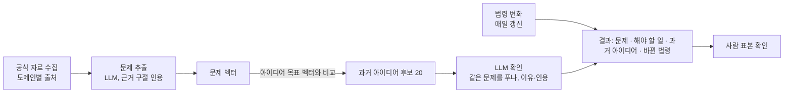

# 최근 문제 → 과거 아이디어 찾기 계획 (검토용)

목표: 최근 공식 자료에서 **지금의 문제**와 **해야 할 일**을 뽑고, 공모전·제안 DB(사용 대상 114,781건)에서 그 문제를 다룬 **과거 아이디어**를 찾아 제안. 바뀐 근거는 **시행된 법령**으로 확인

## 1. 흐름

## 2. 저장 위치

| 단계 | 위치 | 내용 |
|---|---|---|
| 지금 | 이 PC 로컬 DB(Docker `pgvector/pgvector:pg16`) | 서버 `parangsae` 사본 + 새 표. 시범은 전부 여기서 |
| 나중 | 68 서버 `parangsae` | 같은 마이그레이션 파일로 적용. 서버 PostgreSQL 이미지를 `pgvector/pgvector:pg16`으로 교체한 뒤 |

- 로컬과 서버 구조가 같도록 표 변경은 전부 마이그레이션 파일(`master/00NN`)로만 함
- 서버 반영 = 로컬 결과를 그대로 복사하지 않고, 같은 명령을 서버에서 다시 실행하거나 표 단위로 옮긴 뒤 로컬과 비교(지금까지 방식)

## 3. 새로 생기는 표

| 표 | 1행 | 주요 칸 |
|---|---|---|
| `law` | 법령·조례·행정규칙 변화 1건 | 법령 id, 이름, 종류(법률·시행령·조례 등), 소관 기관, 공포일, 시행일, 개정 이유, 도메인 |
| `doc` | 수집한 자료 1건 | 출처, 원문 id, 제목, 날짜, 링크, 본문, 도메인 |
| `issue` | 자료에서 뽑은 문제 1건 | 자료(`doc`), 문제 문장, 해야 할 일, 근거 구절, 근거 확인, 문제 벡터, 지침 버전 |
| `match` | 문제 ↔ 과거 아이디어 1쌍 | 문제, 아이디어(master api·key), 거리, LLM 판정, 이유, 인용, 사람 확인, 지침 버전 |

- master: `embedding_input`(벡터에 넣은 글) + `embedding`(벡터) 칸 추가(`master/0016`, 로컬 적용 완료)
- 문제 ↔ 법령 연결은 `match`처럼 표를 따로 두지 않고, 결과를 만들 때 도메인·날짜·LLM 확인으로 계산. 연결이 많아지면 표 추가 검토

## 4. 법령 최신 유지

| 항목 | 내용 |
|---|---|
| 출처 | 국가법령정보 공동활용 Open API: 법령 연혁·시행일·제정·개정 이유, 자치법규(조례), 행정규칙 |
| 주기 | 매일 1회. 지난 실행 이후 바뀐 것만 받음 |
| 저장 | `law` 표에 추가만(이력 보존). 같은 법령의 다음 개정 = 새 행 |
| 범위 | 전체 목록은 받되, 개정 이유 본문은 도메인 관련 소관 기관 것부터 |
| 필요 | 법령 OC 코드(`.env` `LAW_OC`, 지금 비어 있음 = 시험 계정) |

## 5. 지침 md

| 파일 | 내용 |
|---|---|
| `guides/domains.md` | 도메인 목록, 도메인별 자료 출처·소관 기관·법령 범위(6장 표) |
| `guides/issue.md` | 자료에서 문제·해야 할 일을 뽑는 기준과 예시. 자료에 없는 내용 금지, 근거 구절 인용 |
| `guides/match.md` | 문제와 아이디어가 "같은 문제를 푼다"의 기준과 예시(맞음·아님) |
| `guides/review.md` | 사람 표본 확인 방법, 통과 기준 |

- git으로 관리. 실행 때 지침 파일 내용의 해시를 `issue`·`match` 행에 기록 → 어느 지침으로 만든 결과인지 추적
- 지침 수정 = md만 고치면 됨(코드 변경 없음). 수정 후 다시 돌린 결과는 버전으로 구분

## 6. 도메인별 출처

| 도메인 | 아이디어 | 자료 출처(공식) | 소관 기관(법령 범위) | 상태 |
|---|---:|---|---|---|
| 생활 | 41,051 | 미정 | 미정 | **출처 필요** |
| 과학기술 | 24,605 | 과기정통부 보도자료, 규제샌드박스 승인 | 과기정통부 | 있음 |
| 안전 | 23,230 | 행안부·소방청 보도자료 | 행안부, 소방청 | 있음 |
| 복지 | 21,189 | 복지부 보도자료, 국회 법률안 제안 이유 | 복지부 | 있음 |
| 환경 | 18,660 | 환경부 보도자료 | 환경부 | 있음 |
| 행정 | 15,416 | 행안부 보도자료, 조례 | 행안부, 지자체 | 있음 |
| 문화 | 14,604 | 문체부 정책뉴스 | 문체부 | 있음 |
| 교육 | 14,307 | 교육부 보도자료 | 교육부 | 있음 |
| 교통 | 12,549 | 국토부 보도자료 | 국토부 | 있음 |
| 경제 | 8,400 | 기재부·중기부 보도자료, K-Startup·기업마당 공고 | 기재부, 중기부 | 있음 |
| 보건 | 7,992 | 복지부·질병청 보도자료 | 복지부, 질병청 | 있음 |
| 기타 | 840 | – | – | 제외 |

공통 출처: 국회 법률안 제안 이유, 입법예고·행정예고 개정 이유, 정책브리핑 정책뉴스

- 일반 뉴스: 이용 조건이 확인된 출처만 보조로. 포털 뉴스 크롤링 안 함
- 출처가 실제로 몇 건, 어떤 형식으로 오는지는 키 발급 후 시험해서 이 표에 기록

## 7. 처리 단계

| 단계 | 하는 일 | 방식 |
|---|---|---|
| 수집 | 도메인별 출처에서 최근 자료(시범: 6개월) | 공식 API |
| 문제 추출 | 자료 1건 → 문제 0~3개 + 해야 할 일 + 근거 구절 | LLM(`guides/issue.md`), 근거 구절이 원문에 있으면 확인 |
| 아이디어 벡터 | 사용 대상 아이디어의 목표(끝 상투어 제거) + 해결책 + 핵심 기능 → 벡터 | OpenAI `text-embedding-3-small`, 1536차원 halfvec. 시험(2026-10-22): 최근 문제 100건 → 과거 아이디어 상위 10개 중 같은 문제 목표만 34.4% · 목표+해결책 37.8% · 목표+해결책+기능 38.0%, 관련 이상 76.7% · 79.8% · 80.9% → 마지막으로 결정 |
| 후보 찾기 | 문제 벡터 ↔ 아이디어 벡터 가까운 20개(같은 도메인 우선) | pgvector |
| 확인 | 후보마다 같은 문제를 푸는지 + 이유 + 아이디어 쪽 인용 | LLM(`guides/match.md`) |
| 법령 연결 | 같은 도메인·소관 기관의 시행된 법령 중 관련 있는 것 | 날짜 비교 + LLM 확인 |
| 결과 | 문제 · 해야 할 일 · 근거 자료 · 과거 아이디어(연도·출처·수상) · 바뀐 법령 | xlsx·json 내보내기 |
| 사람 확인 | 문제 추출·연결 표본 | `guides/review.md` |

## 8. 사람 확인(HITL)

| 대상 | 표본 | 통과 기준 |
|---|---:|---|
| 문제 추출이 자료와 맞나 | 100 | 정확 90% 이상 |
| 문제 ↔ 아이디어 연결이 맞나 | 100 | 정확 80% 이상 [기준값 확정 필요] |
| 법령 연결이 맞나 | 50 | 정확 80% 이상 [기준값 확정 필요] |

- 시작 전 작업마다 사람이 판정한 예시 10~20건을 지침에 넣음
- 판정 기준이 애매한 건(LLM 두 번 결과가 다름)은 사람에게

## 9. 시범

| 항목 | 내용 |
|---|---|
| 도메인 | 복지, 교통, 안전 |
| 자료 | 최근 6개월. 도메인별 보도자료 + 국회 법률안 제안 이유 |
| 비용 | 아이디어 벡터 1달러 안팎, 문제 추출·확인 수 달러 [추정] |
| 결과 확인 | 문제 몇 개 → 연결된 과거 아이디어 몇 건, 표본 정확도 |

## 10. 필요한 것

| 항목 | 누가 |
|---|---|
| 법령 OC 코드 | 신청 필요 |
| 공공데이터포털 키(`DATA_GO_KR_KEY`): 보도자료·정책뉴스·공고 API | 신청 필요 |
| 국회 Open API 키 | 신청 필요 |
| 68 서버 PostgreSQL 이미지 교체(서버 반영 때) | 서버 관리자 |

## 11. 정할 것

- 생활 도메인 자료 출처
- 일반 뉴스 사용 여부와 출처
- 사람 확인 통과 기준(8장 [확정 필요])
- 결과 형식(xlsx·json 칸)
